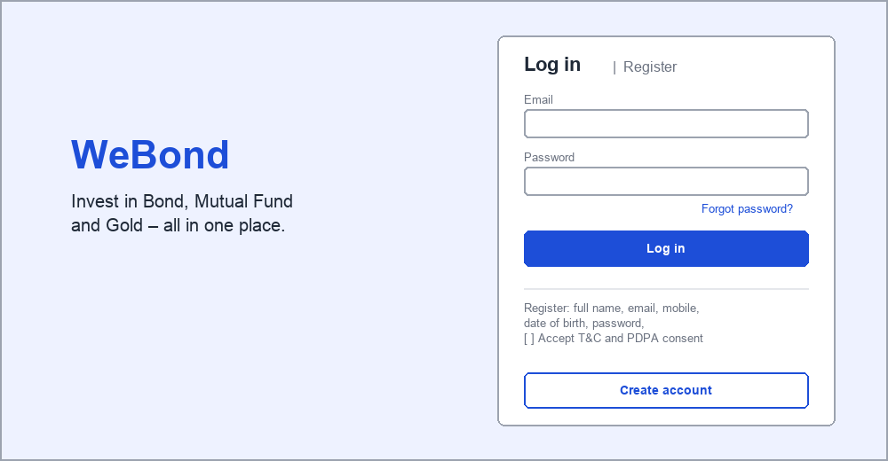
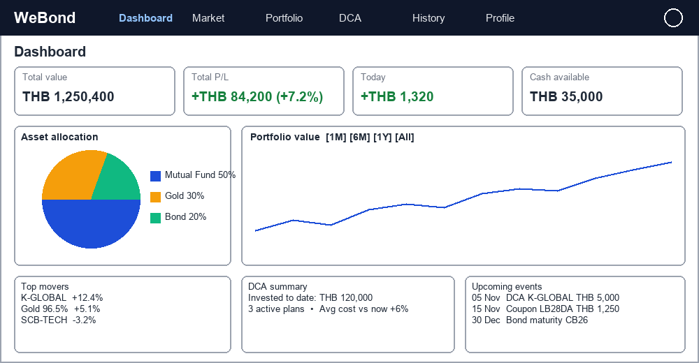
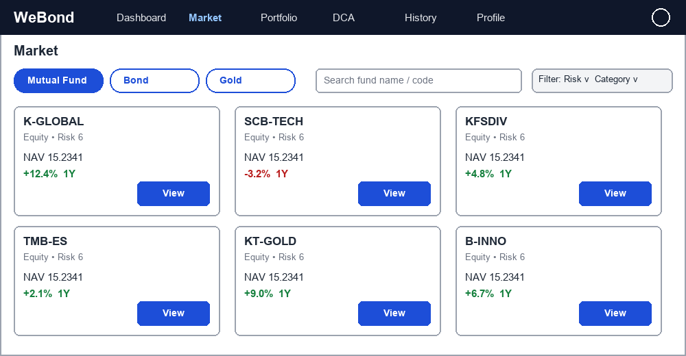
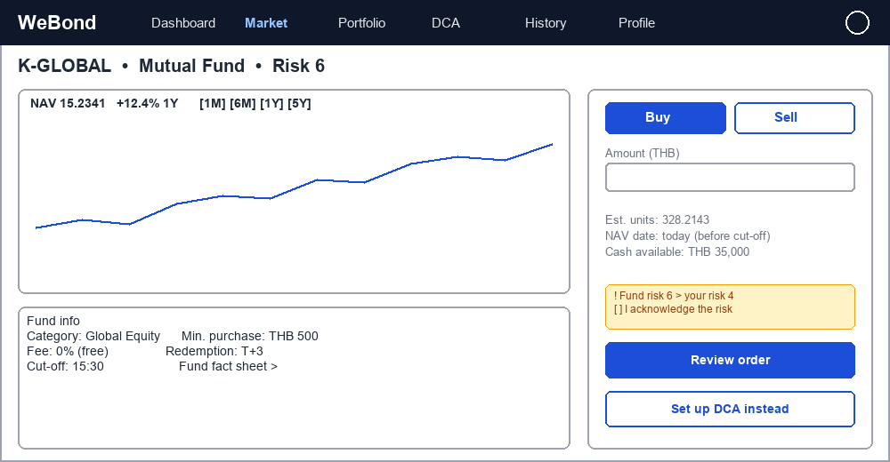
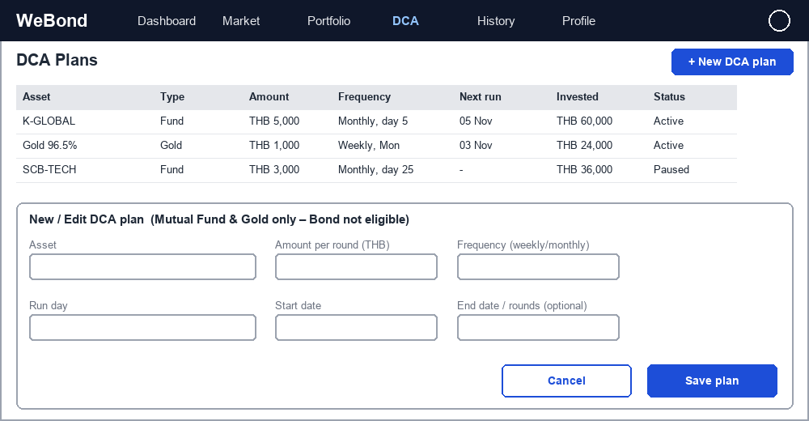
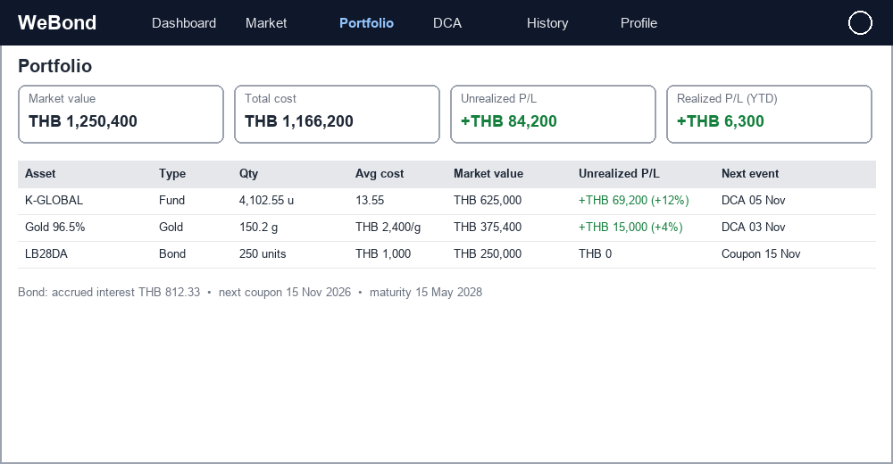
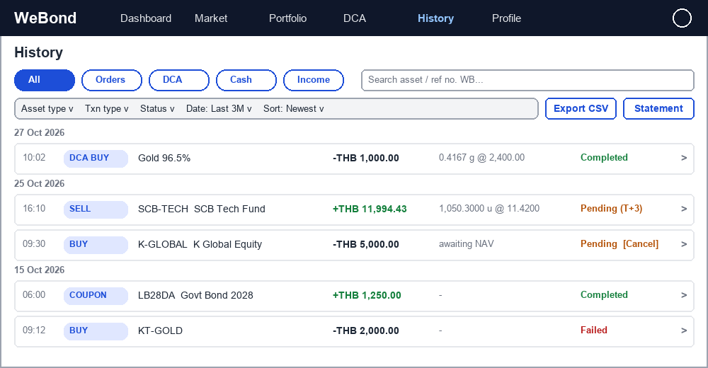
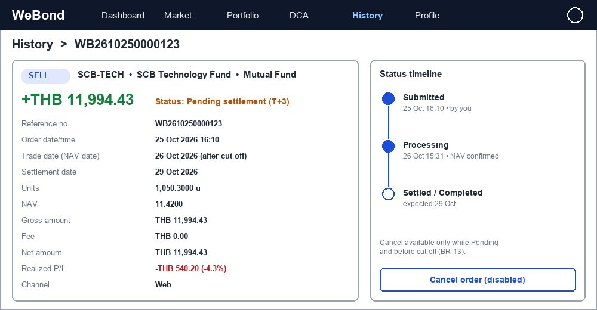
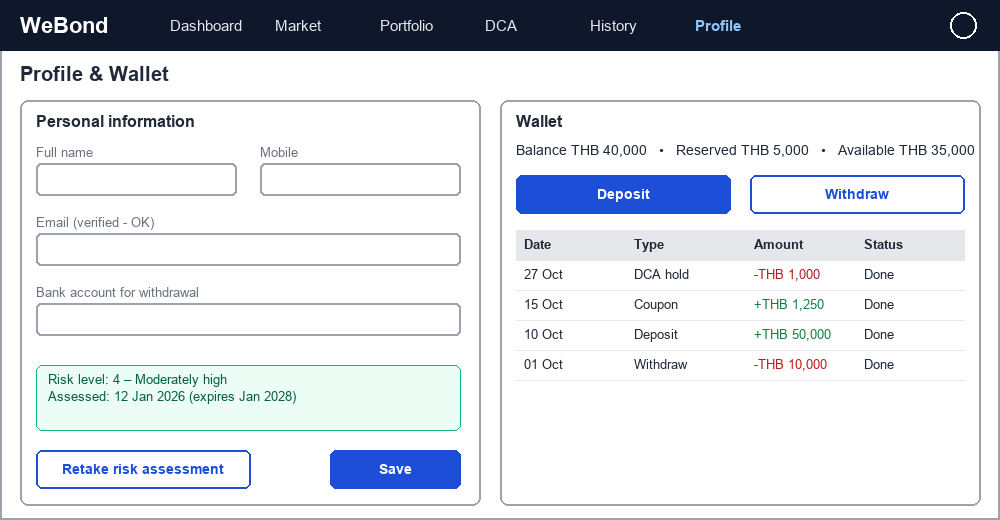

# AIDLC Workshop Training Assessment by MSC

## APP-01 WeBond – Asset Investment & Portfolio Management Platform

## Introduction App / Usecase

- **App ID:** APP-01
- **App / Usecase Name:** WeBond – Asset Investment & Portfolio Management Platform (Bond, Mutual Fund, Gold)
- **Usecase Type (Greenfield/Brownfield):** Greenfield
- **Usecase Type (Option):**

Greenfield prep. (new system – no existing source code / database)
- Use case & requirement document (this sheet)
- UI wireframes (UI DESIGN section) -> to be refined into UI mockups
- To produce in AIDLC: domain model & DB schema (users, wallets, assets, orders, holdings, dca_plans, transactions), OpenAPI spec, architecture diagram, test plan, deployment run-book

- **Related Systems:**

All related systems are MOCKED in phase 1 – mock REST APIs whose data comes from the WeBond database (no separate mock DB):
• Mock Bank / Payment API (deposit, withdraw, direct debit for DCA) – tables: bank_accounts, payment_transactions
• Mock Fund House API (e.g. FundConnext/AMC): fund master, daily NAV, order allotment – tables: funds, fund_navs
• Mock Bond Market API (e.g. ThaiBMA): bond master, offering, price/yield, coupons – tables: bonds, bond_offerings, bond_prices, bond_coupon_schedules
• Mock Gold Price API (e.g. Gold Traders Association): bid/ask prices – tables: gold_products, gold_prices
• Mock Notification API (Email/SMS OTP) – table: notification_outbox (viewable inbox)

- **Systems Scope:** Web-based, standalone application covering: user registration & login, profile & risk-suitability assessment, asset catalog (Mutual Fund, Bond, Gold), cash wallet, Buy / Sell orders for all 3 asset types, DCA (Dollar-Cost Averaging) plans for Mutual Fund and Gold, order & transaction history, portfolio holdings, insight dashboard, notifications and back-office admin for asset/price master. Consists of React web frontend, Go REST API backend and MySQL database.

- **Definitions:** MF = Mutual Fund, NAV = Net Asset Value per unit, DCA = Dollar-Cost Averaging (invest a fixed amount on a fixed schedule), Unit = MF holding unit, Face Value = bond par value, Coupon = periodic bond interest, YTM = Yield to Maturity, Cut-off time = latest order time to get today's NAV, T+n = settlement n business days after trade date, P/L = Profit/Loss, KYC = Know Your Customer, Baht-weight = Thai gold unit (15.244 g)

## Overview Description

- **Product Perspective:** A greenfield retail investment platform where an individual investor can hold and manage multiple asset classes (Bond, Mutual Fund, Gold) in one place: buy/sell, automate investing with DCA, and see a consolidated portfolio with insights (allocation, P/L, performance, upcoming coupons/maturities).

- **User Classes:**

• Investor (Registered User): register, login, complete profile/risk assessment, buy/sell, manage DCA plans, view dashboard & portfolio
• Guest: view landing page and public asset catalog/prices only
• Admin (Back-office): manage asset master (funds, bonds, gold), prices/NAV, users, view audit log
• System Scheduler: executes DCA plans, coupon/maturity events, price refresh jobs
• External Systems: price feeds, payment & order gateways (mocked in phase 1)

- **Assumptions & Constraints:**

• Accessible via Internet on desktop & mobile browsers (responsive)
• Currency: THB only; Timezone: Asia/Bangkok; business-day calendar maintained by Admin
• Phase 1: every external system is a mock REST API (Go, OpenAPI) whose master data, payments and deposit accounts are read from the WeBond MySQL database (seeded with sample data); WeBond calls them only via HTTP adapters, so real providers can replace them later by config
• All money/unit values stored as DECIMAL (never float)
• Investment advice / robo-advisory is out of scope

## Tech Stack

- **Frontend:** React 18 + TypeScript (Vite) + Tailwind CSS + React Router + TanStack Query + Recharts (dashboard charts)
- **Backend:** Go 1.22+ (Gin) REST API + JWT auth + sqlc/GORM + background scheduler (DCA & batch jobs) + OpenAPI spec
- **Database:** MySQL 8.0 (InnoDB, DECIMAL for money) + golang-migrate for schema migration + Redis (price cache, rate limit, session blacklist) Single schema: webond – also the data source for mock APIs (bank_accounts, payment_transactions, funds, fund_navs, bonds, bond_*, gold_products, gold_prices, notification_outbox)
- **Infrastructure:** Docker Compose (local: web, webond-api, mock-api, mysql, redis); AWS: ECS Fargate (Go API + scheduler + mock API), RDS MySQL, ElastiCache Redis, S3 + CloudFront (React static web); CI/CD via GitHub Actions
- **Policies:** Container-based (not serverless – DCA scheduler needs long-running worker); HTTPS only; PDPA compliant; 12-factor config via env vars

## Functional Requirements (FR)

| FR# | Topic | Function Name | Function Detail | Note |
|---|---|---|---|---|
| FR-01 | Account | User Registration | WHEN a guest submits the sign-up form (email, password, full name, mobile no., date of birth, accept T&C/PDPA consent) THE SYSTEM SHALL validate input, check email uniqueness, hash the password (bcrypt), create the account in 'Pending Verification' status and send an email verification link/OTP. | Account becomes 'Active' after email verification |
| FR-02 | Account | Login / Logout | WHEN a user submits valid email + password THE SYSTEM SHALL issue an access token (JWT, 15 min) and refresh token (7 days) and redirect to Dashboard. WHEN the user clicks Logout THE SYSTEM SHALL revoke the refresh token. | Optional 2FA (OTP) for login from new device |
| FR-03 | Account | Forgot / Reset Password | WHEN a user requests password reset THE SYSTEM SHALL send a one-time reset link valid for 15 minutes and invalidate all existing sessions after the password is changed. | Reset link sent even if email not found (no user enumeration) |
| FR-04 | Account | Profile & Risk Suitability Assessment | WHEN a user opens Profile THE SYSTEM SHALL allow editing personal info, bank account for withdrawal, and completing a risk-suitability questionnaire that produces a Risk Level (1–5) stored with the assessment date. | Risk level is used by BR-08 |
| FR-05 | Asset Catalog | Browse & Search Assets | WHEN a user opens the Market page THE SYSTEM SHALL list assets grouped by type (Mutual Fund / Bond / Gold) with filter (type, risk level, fund category, maturity) and search by name/code, showing latest price/NAV/yield and 1-year return. | Guest can view catalog without login |
| FR-06 | Asset Catalog | Asset Detail | WHEN a user selects an asset THE SYSTEM SHALL show detail by type: • MF: NAV history chart, risk level, fee (shown as 0% – free, BR-17), min. purchase, fund fact sheet link • Bond: issuer, coupon rate, coupon frequency, maturity date, YTM, face value, credit rating, offering period • Gold: current buy/sell price, price history chart | Price/NAV history from price table |
| FR-07 | Wallet | Cash Wallet (Deposit / Withdraw) | WHEN a user deposits or withdraws cash THE SYSTEM SHALL record the transaction, update available balance atomically, and show wallet history. Pending order amounts SHALL be reserved (hold) from available balance. | Phase 1: payment is mocked |
| FR-08 | Trading – Mutual Fund | Buy Mutual Fund | WHEN a user places a buy order with an amount (THB) THE SYSTEM SHALL check KYC/suitability, min. purchase and balance, reserve cash, create an order 'Pending', and on NAV confirmation allot units = amount ÷ NAV (4 decimals) and set status 'Completed'. | Follow cut-off rule BR-02 |
| FR-09 | Trading – Mutual Fund | Sell (Redeem) Mutual Fund | WHEN a user places a sell order by units or amount THE SYSTEM SHALL check available units, lock the units, and on NAV confirmation credit proceeds to wallet according to the fund's settlement (T+n). | Units locked until NAV confirmed |
| FR-10 | Trading – Bond | Buy Bond | WHEN a user buys a bond (subscription during offering period or secondary market) THE SYSTEM SHALL validate offering window, min. lot and multiple of face value, deduct cash, and record holding (face value, units, purchase price, coupon schedule). | Bond is NOT eligible for DCA (see BR-06) |
| FR-11 | Trading – Bond | Sell Bond | WHEN a user sells a bond before maturity THE SYSTEM SHALL quote the current clean price + accrued interest, and on confirmation reduce the holding and credit proceeds to wallet. | Secondary-market price from feed |
| FR-12 | Trading – Gold | Buy / Sell Gold | WHEN a user buys or sells gold by THB amount or by weight (gram / baht-weight) THE SYSTEM SHALL lock the current price for 30 seconds, show quote (price, weight, total), execute on confirm, and update gold holding (grams, 4 decimals). | Buy uses ASK price, Sell uses BID price |
| FR-13 | DCA | Create DCA Plan | WHEN a user creates a DCA plan for a Mutual Fund or Gold THE SYSTEM SHALL capture asset, amount per round (THB), frequency (weekly / monthly), run day, start date and optional end date / number of rounds, then show the next execution date. | Only MF & Gold. Bond excluded. |
| FR-14 | DCA | Manage DCA Plan | WHEN a user views DCA Plans THE SYSTEM SHALL list all plans with status (Active / Paused / Completed / Cancelled), total invested, rounds executed and next run date, and allow edit amount/day, pause, resume and cancel. | Changes apply from the next round |
| FR-15 | DCA | DCA Auto-Execution (Scheduler) | WHEN a DCA plan's run date is reached (business day) THE SYSTEM SHALL automatically create a buy order for the plan amount, link it to the plan, and notify the user of success/failure. | Idempotent per plan + run date |
| FR-16 | History | Transaction History List | WHEN a user opens History THE SYSTEM SHALL list all of the user's transactions (Buy, Sell, DCA Buy, Coupon, Maturity, Deposit, Withdraw) of all asset types, newest first, grouped by date, 20 items per page (infinite scroll), showing: date/time, type badge, asset code & name, amount (+/- THB), quantity @ price, status badge. | Default range: last 3 months. Field spec: sheet 'History Spec' |
| FR-17 | History | Filter, Search & Sort | WHEN a user changes filters THE SYSTEM SHALL filter by tab (All / Orders / DCA / Cash / Income), asset type, transaction type, status and date range (7D / 1M / 3M / 6M / 1Y / custom), search by asset code/name or reference no., and sort by date or amount. Filters are kept in the URL query string. | Max range per query 12 months (BR-12) |
| FR-18 | History | Transaction Detail | WHEN a user selects a transaction THE SYSTEM SHALL show the detail page with all fields relevant to its type (amount, fee, net amount, quantity, price/NAV & price date, accrued interest, realized P/L, DCA plan & round, trade/settlement date, reference no.) and a status timeline (Submitted -> Processing -> Completed/Failed/Cancelled). | Fields per type: 'History Spec' section D |
| FR-19 | History | Cancel Pending Order | WHEN a transaction is 'Pending' and cancellable (BR-13) THE SYSTEM SHALL show a Cancel button; on confirm, set status 'Cancelled', release reserved cash/units to the wallet/holding, and record the change in the status timeline. | POST /transactions/{ref}/cancel |
| FR-20 | History | Export & Monthly Statement | WHEN a user clicks Export THE SYSTEM SHALL download the current filtered list as CSV (UTF-8 with BOM for Thai in Excel). WHEN a month ends THE SYSTEM SHALL generate a monthly statement (PDF) with opening/closing balance, all transactions and holdings, downloadable from History. | Statement ready by day 3 of next month |
| FR-21 | Portfolio | Portfolio Holdings | WHEN a user opens Portfolio THE SYSTEM SHALL show each holding with quantity, average cost, market value, unrealized P/L (THB & %), and for bonds: accrued interest, next coupon date and maturity date. | Average-cost method (BR-10) |
| FR-22 | Dashboard | Insight Dashboard | WHEN a user logs in / opens Dashboard THE SYSTEM SHALL display: • Total portfolio value & total P/L (today, all-time) • Asset allocation pie (Bond / MF / Gold) and vs. target risk profile • Portfolio value trend chart (1M / 6M / 1Y / All) • Top gainers / losers • DCA summary (invested to date, avg cost vs. current price) • Upcoming events: coupon payments, bond maturities, next DCA runs | Data refreshed with latest price/NAV |
| FR-23 | Bond Lifecycle | Coupon & Maturity Processing | WHEN a bond coupon date or maturity date is reached THE SYSTEM SHALL credit coupon interest (or principal at maturity) to the user's wallet, record the transaction, and close the holding at maturity. | Batch job, daily |
| FR-24 | Notification | Notifications | WHEN an order completes/fails, a DCA round runs, a coupon is paid or a bond is near maturity (30 days) THE SYSTEM SHALL send an in-app notification and email. | User can turn email notification on/off |
| FR-25 | Back-office | Admin – Asset & Price Management | WHEN an Admin manages master data THE SYSTEM SHALL allow create/edit/deactivate funds, bonds and gold product, upload/update NAV & prices, maintain business-day holiday calendar, and record every change in audit log. | Admin role only; all changes audited |
| FR-26 | Mock External Systems | Mock APIs (backed by WeBond DB) | THE SYSTEM SHALL provide mock REST APIs for every related system (Bank/Payment, Fund House, Bond Market, Gold Price, Notification). The mocks have NO separate database – they read/write tables in the WeBond MySQL database: • Payment & deposit accounts: bank_accounts, payment_transactions • Fund master & NAV: funds, fund_navs • Bond master: bonds, bond_offerings, bond_prices, bond_coupon_schedules • Gold master & price: gold_products, gold_prices • Notification: notification_outbox (viewable inbox for OTP/email) Simulated behaviour: async NAV confirmation, gold price tick every 1 min, configurable latency & error responses; admin endpoints to re-seed data and trigger events (publish NAV, pay coupon). | Master data maintained via FR-25 is the same data the mocks serve. Swap to real provider by config later |

## Non-Functional Requirements (NFR)

| FR# | Topic | Function Name | Function Detail | Note |
|---|---|---|---|---|
| NFR-01 | Security | Authentication & Data Protection | • Passwords hashed with bcrypt (cost ≥ 12) • JWT access/refresh tokens, HTTPS/TLS 1.2+ only • Role-based access control (Investor / Admin) • Encrypt sensitive PII (national ID, bank account) at rest • Protect against OWASP Top 10 (SQLi, XSS, CSRF) | OWASP ASVS L1 as baseline |
| NFR-02 | Security & Compliance | Audit Log & PDPA | • Audit log for login, orders, DCA changes, admin changes (who / what / when / IP) • PDPA consent capture, data masking on screen, right to export/delete data | Audit log retained 5 years |
| NFR-03 | Availability | Service Time | • 99.5% uptime, 24/7 access for viewing • Orders accepted 24/7 but processed by business-day rules | Planned maintenance window Sun 01:00–04:00 |
| NFR-04 | Performance | Response Time & Concurrency | • API p95 response < 500 ms • Dashboard loads < 2 s • Support 1,000 concurrent users • DCA batch processes 10,000 plans within 15 minutes | Verify with load test (k6) |
| NFR-05 | Data Integrity | Financial Accuracy | • Money & units stored as DECIMAL(18,4); no floating point • Order/balance updates in a single DB transaction • Idempotency key on all order APIs to prevent duplicate orders | MySQL InnoDB transactions |
| NFR-06 | Reliability | Backup & Recovery | • Daily automated DB backup, 30-day retention • RPO ≤ 1 hour, RTO ≤ 4 hours | RDS automated backup |
| NFR-07 | Usability | Responsive UI & Language | • Responsive for desktop & mobile browsers • Thai / English language • Number formats with thousand separators, THB currency | Default language: Thai |
| NFR-08 | Maintainability | Observability & Code Quality | • Structured JSON logs, health-check endpoint, metrics (Prometheus/CloudWatch) • Unit test coverage ≥ 70% for backend business logic • API documented with OpenAPI/Swagger | Swagger UI on /docs |

## Exception Cases

| EX# | Topic | Case Name | Case Detail | Note |
|---|---|---|---|---|
| EX-01 | Authentication | Invalid Login / Account Lock | If login fails 5 times in a row, the system SHALL lock the account for 15 minutes and show a generic message 'Invalid email or password' (no hint which is wrong). | Login attempt counter in Redis |
| EX-02 | Registration | Duplicate Email | If the email already exists, the system SHALL reject registration and show 'This email is already registered'. | HTTP 409 Conflict |
| EX-03 | Authentication | Session / Token Expired | If the access token expires, the frontend SHALL silently refresh; if the refresh token is invalid, redirect to Login and keep unsaved order data cleared. | HTTP 401 -> refresh flow |
| EX-04 | Trading | Insufficient Cash Balance | If available balance < order amount, the system SHALL reject the buy order and prompt the user to deposit. | HTTP 422, code INSUFFICIENT_BALANCE |
| EX-05 | Trading | Insufficient Units / Holding | If the sell quantity > available (unlocked) units/grams/bond units, the system SHALL reject the sell order. | HTTP 422, code INSUFFICIENT_HOLDING |
| EX-06 | Trading | Order After Cut-off / Holiday | If a MF order is placed after cut-off time or on a non-business day, the system SHALL warn the user and process it at the next business day's NAV. | Warning only, order still accepted |
| EX-07 | Trading – Bond | Bond Offering Closed / Lot Invalid | If the bond offering period is closed, sold out, or amount is below min. lot / not a multiple of face value, the system SHALL reject the order with reason. | HTTP 422, code BOND_OFFER_INVALID |
| EX-08 | Trading – Gold | Price Quote Expired | If the user confirms after the 30-second price lock, the system SHALL re-quote with the new price and require re-confirmation. | HTTP 409, code QUOTE_EXPIRED |
| EX-09 | DCA | DCA Round Failed | If a DCA round fails (insufficient balance, fund suspended), the system SHALL mark the round 'Failed', notify the user, and NOT retry automatically. After 3 consecutive failures the plan becomes 'Paused'. | Failure reason stored per round |
| EX-10 | Integration | Price Feed Unavailable / Stale | If the latest price is older than the allowed threshold (gold 5 min, NAV 1 business day), the system SHALL block gold trading, show 'Price unavailable', and display last-updated time on dashboard. | Last-updated timestamp always shown |
| EX-11 | Trading | Duplicate Submission | If the same order is submitted twice with the same idempotency key, the system SHALL return the original order and not create a new one. | Header: Idempotency-Key |
| EX-12 | Risk | Asset Risk Exceeds User Risk Level | If the asset risk level > user's risk level, the system SHALL display a risk warning and require explicit acknowledgement before placing the order. | Acknowledgement logged (BR-08) |
| EX-13 | History | Cancel Not Allowed | If the user cancels an order that is past cut-off, already Processing/Completed, or not cancellable by type (Gold, Bond), the system SHALL reject with reason and refresh the status. | HTTP 409, code CANCEL_NOT_ALLOWED |
| EX-14 | History | Date Range Too Large / Export Limit | If the selected range exceeds 12 months or the export exceeds 10,000 rows, the system SHALL ask the user to narrow the range (or use monthly statements). | HTTP 400, code RANGE_TOO_LARGE / EXPORT_TOO_LARGE |
| EX-15 | History | Transaction Not Found / Not Owned | If a reference no. does not exist or belongs to another user, the system SHALL return 404 'Transaction not found' (never reveal other users' data). | HTTP 404, code TXN_NOT_FOUND |
| EX-16 | History | No Transactions | If no transaction matches the filters, the system SHALL show an empty state with 'Clear filters' and a shortcut to Market. | UI empty state only |

## Business Rules

| EX# | Topic | Rule Name | Rule Detail | Note |
|---|---|---|---|---|
| BR-01 | Account | KYC & Suitability Before Trading | User must verify email, complete profile and risk assessment before placing any buy/sell order or DCA plan. Risk assessment expires every 2 years. | Applies to all trading FRs |
| BR-02 | Mutual Fund | Cut-off Time | MF orders placed before 15:30 on a business day get that day's NAV (T+0); after 15:30 or on holidays get next business day's NAV. | Assumption – confirm with business |
| BR-03 | Mutual Fund | Min. Purchase & Settlement | Min. purchase per fund is defined in fund master (default 500 THB). Redemption proceeds credited at T+n per fund (default T+3). | Assumption – confirm with business |
| BR-04 | Bond | Lot Size | Bond purchase must be ≥ min. lot (default 1,000 THB face value) and in multiples of 1,000 THB face value. | Assumption – confirm with business |
| BR-05 | Bond | Coupon & Maturity | Coupon = face value × coupon rate ÷ frequency, credited to wallet on coupon date. Principal returned at maturity, holding closed automatically. | Batch job runs daily 06:00 |
| BR-06 | DCA | DCA Eligible Assets | DCA is available for Mutual Fund and Gold only. Bond is NOT eligible because it is sold in limited offering periods, fixed lot sizes and is normally held to maturity. | Alternative for bond: coupon tracking & maturity reminders |
| BR-07 | DCA | DCA Schedule Rules | Frequency: weekly (Mon–Fri) or monthly (day 1–28). Min. 500 THB per round for MF, 100 THB for Gold. If run date is a holiday, execute on the next business day. | Assumption – confirm with business |
| BR-08 | Risk | Risk Mismatch | User may buy assets above their risk level only after acknowledging the risk warning; acknowledgement is logged. | Stored in audit log |
| BR-09 | Gold | Gold Pricing & Unit | Buy at ASK price, Sell at BID price. Holding stored in grams (4 decimals); display also in baht-weight (1 baht-weight = 15.244 g). Min. order 100 THB. | Assumption – confirm with business |
| BR-10 | Portfolio | Cost & P/L Calculation | Average cost method. Unrealized P/L = market value − total cost; Realized P/L recorded on sell. MF valued at latest NAV, Bond at latest clean price, Gold at BID price. | Used by Portfolio & Dashboard |
| BR-11 | Wallet | Cash Reservation | Cash for pending orders is reserved; Available balance = balance − reserved. Withdrawal allowed only from available balance. | Applies to Wallet & all buy orders |
| BR-12 | History | History Range & Retention | Users can view all transactions since account opening, max 12 months per query/export. Transactions are retained at least 5 years. | Confirmed |
| BR-13 | History | Cancellation Rule | Only 'Pending' MF Buy/Sell and DCA Buy orders can be cancelled, and only before the fund's cut-off time on trade date. Gold and Bond orders execute immediately and cannot be cancelled. Coupon, Maturity, Deposit, Withdraw are system records – not cancellable. | See History Spec section B |
| BR-14 | History | Immutable Records | Transactions are never edited or deleted. Corrections are made by a new reversal/adjustment transaction linked to the original (ref_txn_id). Every status change is written to transaction_status_history. | Table transaction_status_history |
| BR-15 | History | Amount Sign & Display | Amount sign is from the wallet's view: cash IN (Sell, Coupon, Maturity, Deposit) = '+', cash OUT (Buy, DCA Buy, Withdraw) = '-'. Display: THB 2 decimals, MF units 4 decimals, gold grams 4 decimals, time in Asia/Bangkok (dd MMM yyyy HH:mm). | See History Spec section F |
| BR-16 | History | Reference Number | Each transaction has a unique reference no. 'WB' + yyMMdd + 7-digit running no. (e.g. WB2610270000123), shown to the user and used for support and search. | Column transactions.txn_ref |
| BR-17 | Fees | Zero Fee (Phase 1) | All fees are 0 THB for now: MF front-end / back-end / switching fee, bond buy/sell fee, gold buy/sell fee, DCA fee, deposit / withdraw fee. transactions.fee = 0.00 and net amount = gross amount. Gold still uses the BID/ASK price from the price feed (market price, not a WeBond fee). Fee column stays in the data model so fees can be enabled later by configuration without schema change. | Free for now – confirmed |

## UI Design

Wireframe images are extracted to the `images/` folder. Each image maps 1:1 to a UI page (the image was anchored to that page's row in the source spreadsheet).

### Image Mapping

| # | Page | Related FR | Wireframe | Description |
|---|---|---|---|---|
| 1 | Login / Register | FR-01, FR-02, FR-03 | [01-login-register.png](images/01-login-register.png) | Login & sign-up form, email verification, forgot password |
| 2 | Home Page (Dashboard) | FR-22 | [02-dashboard.png](images/02-dashboard.png) | Total value & P/L cards, allocation pie, value trend chart, top movers, DCA summary, upcoming coupons/maturities/DCA runs |
| 3 | Market (Asset Catalog) | FR-05 | [03-market-catalog.png](images/03-market-catalog.png) | Tabs Mutual Fund / Bond / Gold, filters, search, asset cards with price & return |
| 4 | Asset Detail & Buy / Sell | FR-06, FR-08–FR-12 | [04-asset-detail-buy-sell.png](images/04-asset-detail-buy-sell.png) | Price/NAV chart, asset info, Buy/Sell panel with quote & confirm dialog |
| 5 | DCA Plans | FR-13, FR-14 | [05-dca-plans.png](images/05-dca-plans.png) | List of plans with status, create/edit plan form, round history |
| 6 | Portfolio | FR-21 | [06-portfolio.png](images/06-portfolio.png) | Summary cards, holdings table with quantity, avg cost, market value, P/L and next event |
| 7 | History | FR-16, FR-17, FR-20 | [07-history.png](images/07-history.png) | Tabs, filters, search, transaction list grouped by date, Export CSV / Statement |
| 8 | History – Transaction Detail | FR-18, FR-19 | [08-history-transaction-detail.png](images/08-history-transaction-detail.png) | Transaction fields by type, status timeline, Cancel button (when allowed) |
| 9 | Profile & Wallet | FR-04, FR-07 | [09-profile-wallet.png](images/09-profile-wallet.png) | Personal info, risk assessment, bank account, deposit/withdraw, wallet history |

### 1. Login / Register

Login & sign-up form, email verification, forgot password. _(Related: FR-01, FR-02, FR-03)_

### 2. Home Page (Dashboard)

Total value & P/L cards, allocation pie, value trend chart, top movers, DCA summary, upcoming coupons/maturities/DCA runs. _(Related: FR-22)_

### 3. Market (Asset Catalog)

Tabs Mutual Fund / Bond / Gold, filters, search, asset cards with price & return. _(Related: FR-05)_

### 4. Asset Detail & Buy / Sell

Price/NAV chart, asset info, Buy/Sell panel with quote & confirm dialog. _(Related: FR-06, FR-08–FR-12)_

### 5. DCA Plans

List of plans with status, create/edit plan form, round history. _(Related: FR-13, FR-14)_

### 6. Portfolio

Summary cards, holdings table with quantity, avg cost, market value, P/L and next event. _(Related: FR-21)_

### 7. History

Tabs, filters, search, transaction list grouped by date, Export CSV / Statement. _(Related: FR-16, FR-17, FR-20)_

### 8. History – Transaction Detail

Transaction fields by type, status timeline, Cancel button (when allowed). _(Related: FR-18, FR-19)_

### 9. Profile & Wallet

Personal info, risk assessment, bank account, deposit/withdraw, wallet history. _(Related: FR-04, FR-07)_

